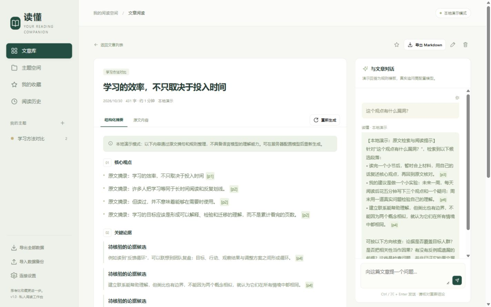

# 读懂 · 个人 AI 阅读助手

一个可以本地运行、持久保存数据的单用户 Web 应用。粘贴文章链接或正文，生成结构化摘要、继续追问，并把多篇文章放进同一主题比较阅读。

## 功能

- **链接 / 文本导入**：提取网页正文，也可直接粘贴文本；抓取失败时可改用文本导入。
- **结构化摘要**：核心观点、关键论据、作者态度、可行动洞察，并显示局限和原文段落引用。
- **文章追问**：保存每篇文章的对话，可从建议问题开始，也可输入自己的问题。
- **主题工作区**：创建、修改、删除主题；把文章归入主题；选择至少两篇生成对比，保存历次对比。
- **阅读管理**：全文搜索、收藏、历史记录、文章删除、重新摘要。
- **可迁移数据**：导出 Markdown 阅读笔记；导出 / 导入 JSON 备份。
- **明确的运行状态**：区分本地演示和真实模型；模型错误会显示失败原因，不会偷偷切换成演示结果。

前端是原生 HTML / CSS / JavaScript，后端是 FastAPI，数据保存在 SQLite。无需 Node.js、前端构建或单独的数据库服务。



已通过 77 项回归测试和浏览器主流程验证，详细执行范围及限制见 [验证记录](docs/verification.md)。

## 最快启动：Docker Compose

安装 Docker Engine / Docker Desktop 和 Compose 插件，在项目根目录运行：

```sh
cp .env.example .env
docker compose up --build -d
```

Windows PowerShell 的复制命令是：

```powershell
Copy-Item .env.example .env
docker compose up --build -d
```

浏览器访问 **http://localhost:8000**。未填写模型密钥即可体验完整流程。

```sh
docker compose logs -f reader
docker compose down
```

SQLite 存在 `reader-data` 命名卷中，停止或重建容器后仍保留。**`docker compose down -v` 会删除数据库卷。** 升级或删除卷之前，先在界面导出备份。

## 本地 Python 启动

需要 Python 3.11 或更新版本；Docker 镜像使用 Python 3.12。在项目根目录执行：

```sh
python -m venv .venv
```

Windows PowerShell：

```powershell
.\.venv\Scripts\Activate.ps1
python -m pip install -r backend/requirements.txt
Copy-Item .env.example .env
python -m uvicorn backend.main:app --host 127.0.0.1 --port 8000
```

macOS / Linux：

```sh
source .venv/bin/activate
python -m pip install -r backend/requirements.txt
cp .env.example .env
python -m uvicorn backend.main:app --host 127.0.0.1 --port 8000
```

访问 **http://localhost:8000**。本地默认数据库位置是 `data/reader.db`。

## 接入真实 AI

编辑 `.env`，填写服务端配置后重新启动服务：

```dotenv
AI_MODE=ai
AI_API_KEY=你的密钥
AI_BASE_URL=https://api.openai.com/v1
AI_MODEL=gpt-4.1-mini
```

应用通过 OpenAI 兼容的 `POST /chat/completions` 协议调用模型。可换成其他兼容服务的根地址和模型名；服务需支持聊天接口及结构化 JSON 输出。密钥只由后端读取，不会下发给浏览器。

Docker 修改配置后执行：

```sh
docker compose up -d --force-recreate
```

| 配置 | 默认值 | 说明 |
| --- | --- | --- |
| `AI_MODE` | `auto` | `auto` 有密钥使用 AI，无密钥使用演示；`demo` 始终演示；`ai` 强制真实模型 |
| `AI_API_KEY` | 空 | OpenAI 兼容服务的 API 密钥 |
| `AI_BASE_URL` | `https://api.openai.com/v1` | API 根地址，不含 `/chat/completions` |
| `AI_MODEL` | `gpt-4.1-mini` | 服务支持的模型标识 |
| `APP_ACCESS_TOKEN` | 空 | 可选访问口令；设置后在网页设置中输入同一口令 |
| `DB_PATH` | `./data/reader.db` | 本地数据库路径；Docker 固定为 `/app/data/reader.db` |
| `PORT` | `8000` | Docker 映射到本机的端口 |

**演示模式的边界**：这是本地抽取和模板功能，用于验证操作流程，不会调用模型，也不能替代语义理解、事实核查或真实推理。文章、追问和对比结果会保存其生成模式。真实 AI 也可能误读文章；请结合原文核验。

## 建议体验流程

1. 点击“添加文章”，粘贴正文，或先使用示例文章。
2. 查看摘要，在原文中核对 `[p1]` 等段落引用。
3. 输入“这个观点有什么漏洞？”；切换文章后再回来，对话仍会保留。
4. 创建主题，把两篇或更多文章放入其中，选择文章进行对比。
5. 刷新页面确认历史记录仍存在，再导出一份 JSON 备份。

## 数据与部署范围

这是面向个人的单用户工具，不含账号体系、多人权限或计费功能。Compose 默认只监听本机回环地址。需要远程使用时，设置足够长的 `APP_ACCESS_TOKEN`，并通过带 HTTPS 的反向代理提供访问；服务本身不提供 TLS。访问口令是整个个人工作区的共享口令，不是用户隔离。

AI 模式会向配置的模型服务发送用于生成结果的文章正文、相关追问或选中的文章内容。链接导入会从服务器访问目标站点。JSON 备份包含原文和对话，应按私人资料保管。浏览器保存的访问口令也属于敏感数据。详细边界见 [数据与安全说明](docs/security.md)。

网页抓取仅支持公开 HTTP(S) 文章。登录、付费墙、验证码、只靠 JavaScript 渲染的页面或站点限制可能导致提取失败，请改为粘贴你有权使用的正文。抓取器限制下载体积、超时和重定向，拒绝本机及内网目标。

## 开发与验证

```sh
python -m pip install -r requirements-dev.txt
python -m pytest
```

测试使用隔离的临时 SQLite 数据库和演示模式，不需要模型密钥，不会触发付费调用。交互式 API 文档为 `/docs`，健康检查为 `/health`。

项目结构：

```text
backend/              FastAPI、数据访问、模型适配、网页提取
frontend/             无构建前端
tests/                API 与安全边界回归测试
docs/                 架构、接口、数据与安全说明
Dockerfile            非 root 容器镜像
compose.yaml          服务与持久化卷
.env.example          配置模板
requirements-dev.txt  测试依赖
```

继续开发请从 [架构说明](docs/architecture.md) 和 [API 说明](docs/api.md) 开始。许可证：MIT。

